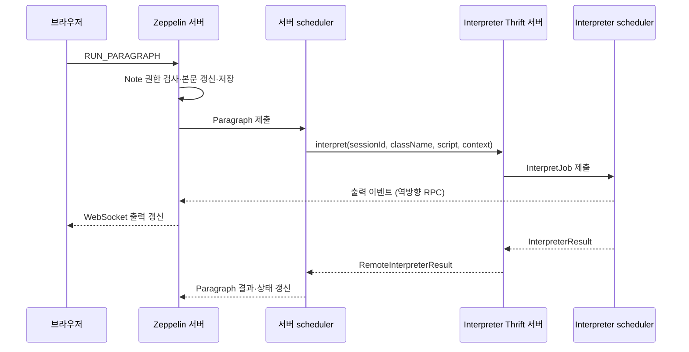

# Apache Zeppelin에서 Paragraph 하나는 어떻게 실행되는가 — 두 scheduler와 왕복 RPC

> 원문 — [Paragraph.java](https://github.com/apache/zeppelin/blob/2ee180ffab215aa18fd167815b65bc23fcc64d1f/zeppelin-server/src/main/java/org/apache/zeppelin/notebook/Paragraph.java), [Apache Zeppelin 소스 2ee180ffa](https://github.com/apache/zeppelin/tree/2ee180ffab215aa18fd167815b65bc23fcc64d1f)
>
> 확인 날짜 — 2026-09-20

> Each paragraph consists of 2 sections: `code section` where you put your source code and `result section` where you can see the result of the code execution.
>
> **번역** — 각 Paragraph는 소스 코드를 넣는 코드 영역과 코드 실행 결과를 볼 수 있는 결과 영역의 두 영역으로 구성됩니다.
>
> — [explore_ui.md](https://github.com/apache/zeppelin/blob/2ee180ffab215aa18fd167815b65bc23fcc64d1f/docs/quickstart/explore_ui.md) (확인: 2026-09-20)

화면에서는 한 번의 Run이지만 remote Interpreter 경로에서는 서버의 Paragraph 작업과 Interpreter 프로세스의 실행 작업이 나뉩니다. **서버 scheduler → Thrift 호출 → Interpreter scheduler**의 경계를 따라가야 대기·실행·출력 문제를 구분할 수 있습니다.

## 실행 환경과 검증 범위

기준은 `/Users/pgt0409/Desktop/git/zeppelin`의 커밋 `2ee180ffab215aa18fd167815b65bc23fcc64d1f`, 버전 **0.13.0-SNAPSHOT**입니다. 릴리스 버전이나 이동하는 `latest` 문서와 동일시하지 않습니다. 확인 환경은 macOS 15.7.4 (24G517), arm64, Python 3.9.6, OpenJDK 11.0.31입니다. 아래 소스 조회 명령은 2026-09-20에 실행했습니다. **Zeppelin 서버·Interpreter 기동은 미실행**이며, 호출 순서와 조건은 해당 커밋의 소스 분석 결과입니다.

## `%python` 한 칸의 실행 경로

다음은 Python Interpreter가 설치·설정됐다는 전제의 최소 예시이며, 이번에 실행한 결과는 아닙니다.

```python
%python
print(1 + 1)
```



중간 출력 화살표는 별도의 event client를 거치는 요약입니다. 프로세스 생성이 필요한 첫 실행은 아래 초기화 경로가 추가되며, personalized mode에서는 설명하는 출력 브로드캐스트가 제한됩니다.

— [Paragraph.java](https://github.com/apache/zeppelin/blob/2ee180ffab215aa18fd167815b65bc23fcc64d1f/zeppelin-server/src/main/java/org/apache/zeppelin/notebook/Paragraph.java#L330-L501) (확인: 2026-09-20)
— [RemoteInterpreterServer.java](https://github.com/apache/zeppelin/blob/2ee180ffab215aa18fd167815b65bc23fcc64d1f/zeppelin-interpreter/src/main/java/org/apache/zeppelin/interpreter/remote/RemoteInterpreterServer.java#L507-L579) (확인: 2026-09-20)

## WebSocket 성공 콜백은 실행 성공을 보장하지 않습니다

`NotebookServer.runParagraph()`는 `id`, `paragraph`, `title`, `params`, `config`를 읽고 Note ID는 연결에서 얻습니다. `NotebookService.runParagraph()`에 `failIfDisabled=false`, `blocking=false`를 전달합니다.

서비스는 Note의 `Permission.RUNNER`를 검사하고 Paragraph를 찾은 다음 내용을 갱신하고 저장합니다. personalized mode에서는 소유자만 master Paragraph를 변경하고, 실행 사용자의 사본은 별도로 갱신합니다. 따라서 비소유자가 실행한 코드를 모든 사용자가 공유하는 원본 코드라고 보면 안 됩니다.

— [NotebookServer.java](https://github.com/apache/zeppelin/blob/2ee180ffab215aa18fd167815b65bc23fcc64d1f/zeppelin-server/src/main/java/org/apache/zeppelin/socket/NotebookServer.java#L1618-L1655) (확인: 2026-09-20)
— [NotebookService.java](https://github.com/apache/zeppelin/blob/2ee180ffab215aa18fd167815b65bc23fcc64d1f/zeppelin-server/src/main/java/org/apache/zeppelin/service/NotebookService.java#L439-L499) (확인: 2026-09-20)

핵심 코드는 다음과 같습니다.

```java
notebook.saveNote(note, context.getAutheInfo());
note.run(p.getId(), sessionId, blocking, context.getAutheInfo().getUser());
callback.onSuccess(p, context);
return true;
```

`note.run()`의 boolean 반환값을 검사하지 않습니다. `Paragraph.execute()`가 Interpreter를 찾지 못해 `false`를 반환하더라도 예외가 밖으로 나오지 않으면 서비스는 `onSuccess`를 호출할 수 있습니다. 따라서 콜백은 **사용자 코드 성공뿐 아니라 작업 제출 성공까지도 증명하지 못합니다.** Paragraph 상태와 결과를 함께 확인해야 합니다.

반면 이 try 블록에서 예외가 발생하면 `onFailure` 대신 Paragraph의 결과와 상태를 `ERROR`로 바꿉니다. 오류 팝업이 없다는 이유로 실행 성공을 판단할 수도 없습니다. 성공 콜백에는 마지막 Paragraph가 비어 있지 않으면 새 빈 Paragraph를 추가하는 UI 편의 처리도 있습니다.

— [NotebookService.java](https://github.com/apache/zeppelin/blob/2ee180ffab215aa18fd167815b65bc23fcc64d1f/zeppelin-server/src/main/java/org/apache/zeppelin/service/NotebookService.java#L502-L513) (확인: 2026-09-20)
— [Paragraph.java](https://github.com/apache/zeppelin/blob/2ee180ffab215aa18fd167815b65bc23fcc64d1f/zeppelin-server/src/main/java/org/apache/zeppelin/notebook/Paragraph.java#L330-L382) (확인: 2026-09-20)
— [NotebookServer.java](https://github.com/apache/zeppelin/blob/2ee180ffab215aa18fd167815b65bc23fcc64d1f/zeppelin-server/src/main/java/org/apache/zeppelin/socket/NotebookServer.java#L1631-L1651) (확인: 2026-09-20)

## 첫 번째 scheduler는 서버 JVM에 있습니다

`Note.run()`은 필요한 경우 사용자별 Paragraph를 선택하고 listener를 설정한 뒤 `Paragraph.execute()`를 호출합니다. `execute()`는 Interpreter 조회와 설정 병합, 이전 출력 초기화, `PENDING` 전환을 수행합니다.

본문이 비어 있거나 Paragraph가 비활성화돼 있으면 제출하지 않고 `FINISHED`로 끝냅니다. 이 분기 전에도 Interpreter 조회는 수행되므로 “빈 칸이면 어떤 설정에서도 오류가 없다”는 뜻은 아닙니다. 정상적인 Interpreter 설정 아래에서 비활성화된 칸을 실행하면 **코드를 실행하지 않고도 FINISHED가 될 수 있다**는 것이 최소 반례입니다.

— [Note.java](https://github.com/apache/zeppelin/blob/2ee180ffab215aa18fd167815b65bc23fcc64d1f/zeppelin-server/src/main/java/org/apache/zeppelin/notebook/Note.java#L774-L785) (확인: 2026-09-20)
— [Paragraph.java](https://github.com/apache/zeppelin/blob/2ee180ffab215aa18fd167815b65bc23fcc64d1f/zeppelin-server/src/main/java/org/apache/zeppelin/notebook/Paragraph.java#L330-L382) (확인: 2026-09-20)

실제 작업은 `interpreter.getScheduler().submit(this)`로 제출합니다. remote 경로의 `RemoteInterpreter.getScheduler()`는 기본 `.execution.mode=paragraph`에서 group ID와 session ID로 이름을 만든 `RemoteScheduler`를 재사용합니다. `note` 실행 모드에서는 Note ID로 이름을 만듭니다. 이는 Quartz cron scheduler와 다른 실행 큐입니다.

— [RemoteInterpreter.java](https://github.com/apache/zeppelin/blob/2ee180ffab215aa18fd167815b65bc23fcc64d1f/zeppelin-server/src/main/java/org/apache/zeppelin/interpreter/remote/RemoteInterpreter.java#L356-L375) (확인: 2026-09-20)

`Paragraph.jobRun()`은 Setting이 `READY`인지 확인하고 조건에 따라 Interpreter 사용 권한을 다시 검사합니다. form 값을 script에 반영하고 `InterpreterContext`를 설정한 뒤 `interpret()`를 부릅니다. credential 주입이 켜졌으면 치환된 코드를 실행하고 결과의 비밀번호를 가리는 경로를 사용합니다. 따라서 RPC로 넘어가는 script가 화면 원문과 항상 같지는 않습니다. `finally`에서 thread-local Context를 제거합니다.

— [Paragraph.java](https://github.com/apache/zeppelin/blob/2ee180ffab215aa18fd167815b65bc23fcc64d1f/zeppelin-server/src/main/java/org/apache/zeppelin/notebook/Paragraph.java#L394-L501) (확인: 2026-09-20)

## 프로세스와 session은 별도로 선택합니다

`InterpreterSetting`은 group ID와 session ID를 계산합니다. 일반 관리 프로세스에서 per note만 비교하면 다음과 같습니다.

| per note / per user | Note A·B의 프로세스 선택 | session 선택 |
| --- | --- | --- |
| shared / shared | 같은 `설정ID-shared_process` | 같은 `shared_session` |
| scoped / shared | 같은 `설정ID-shared_process` | A, B |
| isolated / shared | `설정ID-A`, `설정ID-B` | 각 프로세스의 `shared_session` |

per user도 isolated이면 group ID에 사용자 이름이 추가됩니다. scoped 축은 session ID에 반영됩니다. 명시적 group ID가 있으면 그것을 우선하고, 실행 Context의 일회성 isolated 모드와 existing-process 모드에도 별도 분기가 있습니다. 따라서 위 표는 모든 실행 모드의 전체 목록이 아닙니다.

— [InterpreterSetting.java](https://github.com/apache/zeppelin/blob/2ee180ffab215aa18fd167815b65bc23fcc64d1f/zeppelin-server/src/main/java/org/apache/zeppelin/interpreter/InterpreterSetting.java#L405-L448) (확인: 2026-09-20)

`ManagedInterpreterGroup.getOrCreateInterpreterProcess()`는 lock 안에서 프로세스 참조가 없을 때만 생성·start·init을 수행하고 이후 재사용합니다. 같은 등록 그룹 이름을 쓴다고 모두 동일한 런타임 JVM에 붙는 것은 아니며, 앞서 계산한 ID가 중요합니다. 프로세스 참조 하나는 아직 시작되지 않았거나 종료된 상태일 수도 있으므로 “그룹 하나가 있으면 살아 있는 JVM 하나가 반드시 있다”고 읽지 않습니다.

— [ManagedInterpreterGroup.java](https://github.com/apache/zeppelin/blob/2ee180ffab215aa18fd167815b65bc23fcc64d1f/zeppelin-server/src/main/java/org/apache/zeppelin/interpreter/ManagedInterpreterGroup.java#L43-L91) (확인: 2026-09-20)

## 첫 실행에는 등록과 초기화가 추가됩니다

로컬 `ExecRemoteInterpreterProcess`는 runner에 Interpreter 디렉터리(`-d`), 서버 event 주소(`-c`, `-p`), Interpreter 포트 범위(`-r`), group ID(`-i`), local repo(`-l`), setting 이름(`-g`)을 전달합니다. impersonation 조건에 따라 사용자 인자(`-u`)도 붙습니다. 시작 후 readiness를 기다리며 시간 초과 시 오류를 냅니다.

— [ExecRemoteInterpreterProcess.java](https://github.com/apache/zeppelin/blob/2ee180ffab215aa18fd167815b65bc23fcc64d1f/zeppelin-server/src/main/java/org/apache/zeppelin/interpreter/remote/ExecRemoteInterpreterProcess.java#L62-L109) (확인: 2026-09-20)

Interpreter의 `RegisterRunnable`은 자기 Thrift 서버가 serving 상태인지 기다린 뒤 서버의 event service에 host·port·group ID를 등록합니다. 등록 호출이 실패하면 Interpreter는 shutdown을 시도합니다. 따라서 서버→Interpreter 연결만 가능하고 Interpreter→서버 event 포트가 막혀 있으면 정상적인 첫 실행 경로를 완성할 수 없습니다.

— [RemoteInterpreterServer.java](https://github.com/apache/zeppelin/blob/2ee180ffab215aa18fd167815b65bc23fcc64d1f/zeppelin-interpreter/src/main/java/org/apache/zeppelin/interpreter/remote/RemoteInterpreterServer.java#L581-L610) (확인: 2026-09-20)

이후 프로세스 `init`, Interpreter 생성, lazy open을 거칩니다. 실제 언어 Interpreter의 `open()`과 precode는 `InterpretJob.jobRun()`에서 처음 열릴 때 처리될 수 있습니다. 프로세스가 등록됐다는 사실과 언어 런타임 초기화가 끝났다는 사실은 다릅니다.

— [RemoteInterpreterServer.java](https://github.com/apache/zeppelin/blob/2ee180ffab215aa18fd167815b65bc23fcc64d1f/zeppelin-interpreter/src/main/java/org/apache/zeppelin/interpreter/remote/RemoteInterpreterServer.java#L796-L826) (확인: 2026-09-20)

## Thrift 요청은 script 이상의 정보를 보냅니다

```thrift
RemoteInterpreterResult interpret(
  1: string sessionId,
  2: string className,
  3: string st,
  4: RemoteInterpreterContext interpreterContext
) throws (1: InterpreterRPCException ex);
```

서버의 `RemoteInterpreter`는 프로세스가 running인지 검사하고 이 RPC를 호출합니다. Context는 인증 정보·Paragraph 식별자·form/config 등 실행 맥락을 운반합니다. 결과가 돌아오면 결과 코드뿐 아니라 config와 form 유형에 따른 GUI 정보도 서버 Context에 반영합니다.

— [RemoteInterpreterService.thrift](https://github.com/apache/zeppelin/blob/2ee180ffab215aa18fd167815b65bc23fcc64d1f/zeppelin-interpreter/src/main/thrift/RemoteInterpreterService.thrift#L93-L104) (확인: 2026-09-20)
— [RemoteInterpreter.java](https://github.com/apache/zeppelin/blob/2ee180ffab215aa18fd167815b65bc23fcc64d1f/zeppelin-server/src/main/java/org/apache/zeppelin/interpreter/remote/RemoteInterpreter.java#L204-L260) (확인: 2026-09-20)

통신은 HTTP가 아니라 `TSocket`과 `TBinaryProtocol`을 사용하는 Thrift 경로이며, client는 `PooledRemoteClient`로 관리됩니다. 따라서 HTTP API 정상만 확인해서는 Interpreter RPC 연결 정상까지 확인한 것이 아닙니다.

— [RemoteInterpreterProcess.java](https://github.com/apache/zeppelin/blob/2ee180ffab215aa18fd167815b65bc23fcc64d1f/zeppelin-server/src/main/java/org/apache/zeppelin/interpreter/remote/RemoteInterpreterProcess.java#L51-L70) (확인: 2026-09-20)

## 두 번째 scheduler와 완료 대기

Interpreter 쪽 `RemoteInterpreterServer.interpret()`는 session·class로 Interpreter를 찾고 `InterpretJob`을 생성해 그 Interpreter의 scheduler에 제출합니다. 이번 소스 검색 결과에서도 두 제출 지점을 확인할 수 있습니다.

```bash
rg -n 'submit\(this\)|submit\(interpretJob\)|jobListener.wait\(1000\)' zeppelin-server/src/main/java/org/apache/zeppelin/notebook/Paragraph.java zeppelin-interpreter/src/main/java/org/apache/zeppelin/interpreter/remote/RemoteInterpreterServer.java
```

```text
zeppelin-server/src/main/java/org/apache/zeppelin/notebook/Paragraph.java:355:        interpreter.getScheduler().submit(this);
zeppelin-server/src/main/java/org/apache/zeppelin/notebook/Paragraph.java:835:        interpreter.getScheduler().submit(this);
zeppelin-interpreter/src/main/java/org/apache/zeppelin/interpreter/remote/RemoteInterpreterServer.java:547:        scheduler.submit(interpretJob);
zeppelin-interpreter/src/main/java/org/apache/zeppelin/interpreter/remote/RemoteInterpreterServer.java:554:            jobListener.wait(1000);
```

`Paragraph.java`의 835행은 별도 recovery 경로의 제출입니다. 일반 실행은 355행, 원격 작업 제출은 547행입니다. 이 출력은 **소스 위치 조회 기록**이며 실제 scheduler 실행 로그가 아닙니다.

Thrift 호출 스레드는 `jobListener.wait(1000)`으로 기다립니다. 하지만 상태 변경 listener의 `notifyAll()`이 먼저 깨울 수 있으므로 “항상 1초 지연”이라는 뜻은 아닙니다. 실제 사용자 코드는 scheduler에서 `InterpretJob.jobRun()` → lazy open/precode → hooks → `interpreter.interpret()` 순서로 실행되며, precode가 실패하면 본문 실행을 건너뛸 수 있습니다.

— [RemoteInterpreterServer.java](https://github.com/apache/zeppelin/blob/2ee180ffab215aa18fd167815b65bc23fcc64d1f/zeppelin-interpreter/src/main/java/org/apache/zeppelin/interpreter/remote/RemoteInterpreterServer.java#L537-L579) (확인: 2026-09-20)
— [RemoteInterpreterServer.java](https://github.com/apache/zeppelin/blob/2ee180ffab215aa18fd167815b65bc23fcc64d1f/zeppelin-interpreter/src/main/java/org/apache/zeppelin/interpreter/remote/RemoteInterpreterServer.java#L704-L715) (확인: 2026-09-20)
— [RemoteInterpreterServer.java](https://github.com/apache/zeppelin/blob/2ee180ffab215aa18fd167815b65bc23fcc64d1f/zeppelin-interpreter/src/main/java/org/apache/zeppelin/interpreter/remote/RemoteInterpreterServer.java#L796-L842) (확인: 2026-09-20)

`isRecover=true` 요청은 새 작업을 만들지 않고 `runningJobs`에서 기존 Paragraph ID를 조회합니다. 종료된 작업은 설정된 cache 시간 뒤 제거되므로 이미 사라졌으면 복구 오류를 반환합니다. recovery는 동일 코드를 무조건 재실행하는 동작이 아닙니다.

— [RemoteInterpreterServer.java](https://github.com/apache/zeppelin/blob/2ee180ffab215aa18fd167815b65bc23fcc64d1f/zeppelin-interpreter/src/main/java/org/apache/zeppelin/interpreter/remote/RemoteInterpreterServer.java#L521-L565) (확인: 2026-09-20)

## 중간 출력과 최종 결과는 다른 경로입니다

최종 결과는 `interpret()` 반환값이고, 중간 출력은 Interpreter가 서버의 `RemoteInterpreterEventService`에 `appendOutput`·`updateOutput` 등을 호출하는 역방향 경로입니다. 서버는 출력 buffer와 WebSocket 메시지를 처리합니다. “계산은 끝났지만 중간 출력이 안 보인다”는 증상은 결과 반환 경로만 조사해서는 설명되지 않습니다.

— [RemoteInterpreterEventService.thrift](https://github.com/apache/zeppelin/blob/2ee180ffab215aa18fd167815b65bc23fcc64d1f/zeppelin-interpreter/src/main/thrift/RemoteInterpreterEventService.thrift#L111-L125) (확인: 2026-09-20)
— [RemoteInterpreterEventClient.java](https://github.com/apache/zeppelin/blob/2ee180ffab215aa18fd167815b65bc23fcc64d1f/zeppelin-interpreter/src/main/java/org/apache/zeppelin/interpreter/remote/RemoteInterpreterEventClient.java#L224-L235) (확인: 2026-09-20)

personalized mode에서는 일반 Paragraph streaming event에 실행 소유자 정보가 없다는 이유로 `NotebookServer`가 공유 buffer 갱신과 broadcast를 제한합니다. 사용자별 terminal snapshot을 받는 경로와 구분해야 합니다. 이 설명은 해당 Paragraph 출력 callback에 대한 것이며, 모든 종류의 Helium application 이벤트까지 같은 분기라고 일반화하지 않습니다.

— [NotebookServer.java](https://github.com/apache/zeppelin/blob/2ee180ffab215aa18fd167815b65bc23fcc64d1f/zeppelin-server/src/main/java/org/apache/zeppelin/socket/NotebookServer.java#L1754-L1855) (확인: 2026-09-20)

## 확인하지 못한 것

- 브라우저→Thrift→출력의 실제 시간 순서·PID·포트는 **미실행**입니다 — 서버와 Interpreter를 기동하지 않았습니다.
- Interpreter 종류별 원격 scheduler의 동시성·성능은 **확인 필요**입니다 — 공통 제출 경로와 서버 `RemoteScheduler` 선택까지만 확인했습니다.
- Docker·Kubernetes launcher와 외부 프로세스 연결의 실제 동작은 **미실행**입니다 — 로컬 프로세스 경로를 중심으로 읽었습니다.
- recovery cache 만료·personalized 출력 제한의 실제 UI 증상은 **미실행**입니다 — 해당 조건문의 존재와 결과 전달 경로만 대조했습니다.

*작성일: 2026-09-20*
