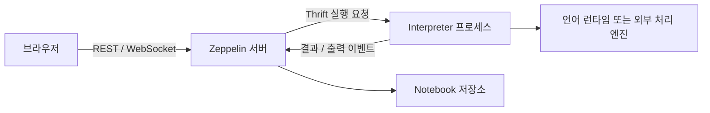

# Apache Zeppelin이란 무엇인가 — Notebook과 실행 백엔드를 연결하는 계층

> 원문 — [index.md](https://github.com/apache/zeppelin/blob/2ee180ffab215aa18fd167815b65bc23fcc64d1f/docs/index.md), [Apache Zeppelin 소스 2ee180ffa](https://github.com/apache/zeppelin/tree/2ee180ffab215aa18fd167815b65bc23fcc64d1f)
>
> 확인 날짜 — 2026-09-20

> Multi-purpose notebook which supports 20+ language backends
>
> **번역** — 20개가 넘는 언어 백엔드를 지원하는 다목적 Notebook입니다.
>
> — [index.md](https://github.com/apache/zeppelin/blob/2ee180ffab215aa18fd167815b65bc23fcc64d1f/docs/index.md) (확인: 2026-09-20)

Zeppelin은 코드·결과·설명을 Notebook에 모으고, Interpreter를 통해 실행 백엔드에 연결합니다. 이 정의를 실행 구조로 풀면 **Notebook은 분석 문서, Paragraph는 실행 단위, Interpreter는 언어·백엔드 연결점**입니다. SQL을 적는 화면과 SQL을 실행하는 데이터베이스를 구분해야 접속 실패를 어느 계층에서 조사할지 정할 수 있습니다.

— [explore_ui.md](https://github.com/apache/zeppelin/blob/2ee180ffab215aa18fd167815b65bc23fcc64d1f/docs/quickstart/explore_ui.md) (확인: 2026-09-20)

## 실행 환경과 검증 범위

기준은 `/Users/pgt0409/Desktop/git/zeppelin`의 커밋 `2ee180ffab215aa18fd167815b65bc23fcc64d1f`, 버전 **0.13.0-SNAPSHOT**입니다. 릴리스 버전이나 이동하는 `latest` 문서와 동일시하지 않습니다. 확인 환경은 macOS 15.7.4 (24G517), arm64, Python 3.9.6, OpenJDK 11.0.31입니다. 아래 소스 조회 명령은 2026-09-20에 실행했습니다. **Zeppelin 서버·Interpreter 기동은 미실행**이며, 호출 순서와 조건은 해당 커밋의 소스 분석 결과입니다.

## 가장 작은 Notebook으로 구조를 구분합니다

다음은 두 Paragraph로 구성한 예시입니다. 실행 출력이 아니며, JDBC 연결과 PostgreSQL 드라이버를 설정한 `jdbc` Interpreter가 필요합니다.

```text
Paragraph A
%md
이번 조회는 연결 상태만 확인합니다.

Paragraph B
%jdbc
SELECT 1 AS connection_check;
```

A는 설명을 렌더링하고 B는 JDBC로 SQL을 보냅니다. SQL 문장이 맞아도 Interpreter 설정·드라이버·접속 정보가 없으면 B는 실행되지 않습니다. Notebook 파일을 공유했다는 사실만으로 상대방의 실행 환경까지 갖춰지지는 않습니다.

— [jdbc.md](https://github.com/apache/zeppelin/blob/2ee180ffab215aa18fd167815b65bc23fcc64d1f/docs/interpreter/jdbc.md) (확인: 2026-09-20)
— [markdown.md](https://github.com/apache/zeppelin/blob/2ee180ffab215aa18fd167815b65bc23fcc64d1f/docs/interpreter/markdown.md) (확인: 2026-09-20)

> A Zeppelin interpreter is a plug-in which enables Zeppelin users to use a specific language/data-processing-backend.
>
> **번역** — Zeppelin Interpreter는 사용자가 특정 언어 또는 데이터 처리 백엔드를 사용할 수 있게 하는 플러그인입니다.
>
> — [overview.md](https://github.com/apache/zeppelin/blob/2ee180ffab215aa18fd167815b65bc23fcc64d1f/docs/usage/interpreter/overview.md) (확인: 2026-09-20)

`%spark.pyspark`처럼 그룹과 Interpreter 이름을 함께 지정할 수 있습니다. 이때 `spark`라는 등록 그룹 이름, 사용자가 만든 Interpreter **설정**, 실제 실행 중인 `ManagedInterpreterGroup`을 같은 객체로 생각하면 안 됩니다. 설정의 binding mode에 따라 하나의 설정에서 여러 런타임 그룹이 만들어집니다.

— [InterpreterSetting.java](https://github.com/apache/zeppelin/blob/2ee180ffab215aa18fd167815b65bc23fcc64d1f/zeppelin-server/src/main/java/org/apache/zeppelin/interpreter/InterpreterSetting.java#L405-L484) (확인: 2026-09-20)

## 서버와 Interpreter는 다른 일을 합니다



이 그림은 소스의 remote Interpreter 경로를 요약한 것입니다. 서버는 Note 권한과 Paragraph 상태를 관리하고, `RemoteInterpreter`는 실행을 원격 프로세스에 위임합니다. 예를 들어 `%spark.pyspark`의 실행을 이해하려면 서버 JVM, Interpreter JVM, 그 뒤의 Python·Spark 실행 환경을 구분해야 합니다. **Interpreter Group이 관리하는 프로세스 참조가 하나라는 사실이 전체 실행에 OS 프로세스가 하나뿐이라는 뜻은 아닙니다.**

— [RemoteInterpreter.java](https://github.com/apache/zeppelin/blob/2ee180ffab215aa18fd167815b65bc23fcc64d1f/zeppelin-server/src/main/java/org/apache/zeppelin/interpreter/remote/RemoteInterpreter.java#L204-L260) (확인: 2026-09-20)
— [ManagedInterpreterGroup.java](https://github.com/apache/zeppelin/blob/2ee180ffab215aa18fd167815b65bc23fcc64d1f/zeppelin-server/src/main/java/org/apache/zeppelin/interpreter/ManagedInterpreterGroup.java#L43-L91) (확인: 2026-09-20)
— [PySparkInterpreter.java](https://github.com/apache/zeppelin/blob/2ee180ffab215aa18fd167815b65bc23fcc64d1f/spark/interpreter/src/main/java/org/apache/zeppelin/spark/PySparkInterpreter.java) (확인: 2026-09-20)

## 공유 범위는 프로세스와 session을 따로 봅니다

일반적인 서버 관리 프로세스에서 group ID는 프로세스 선택에, session ID는 그 안의 Interpreter 인스턴스 집합 선택에 쓰입니다. 아래는 **per user를 shared로 고정하고 per note만 바꾼** 경우입니다. 외부 프로세스 연결, 명시적 group ID, 일회성 isolated 실행은 제외합니다.

| per note | Note A와 B의 group ID | session ID | 결과 |
| --- | --- | --- | --- |
| `shared` | 둘 다 `설정ID-shared_process` | 둘 다 `shared_session` | 같은 Interpreter 인스턴스 집합을 사용합니다. |
| `scoped` | 둘 다 `설정ID-shared_process` | 각각 A, B | 인스턴스 집합은 다르지만 프로세스는 공유합니다. |
| `isolated` | 각각 `설정ID-A`, `설정ID-B` | 각 프로세스 안에서 `shared_session` | 프로세스를 나눕니다. |

따라서 `scoped`로 설정한 A의 Interpreter JVM이 종료되면 B도 영향을 받습니다. 반대로 `isolated`여도 외부 데이터베이스·파일·Spark 클러스터까지 분리되는 것은 이 ID 계산이 보장하지 않습니다. 실무 판단으로는 “변수 상태를 나눌 것인가”와 “프로세스 장애를 나눌 것인가”를 별개의 질문으로 정해야 합니다.

per user와 per note를 함께 쓰면 isolated로 지정된 축은 group ID에, scoped로 지정된 축은 session ID에 반영됩니다. 둘 다 isolated이면 group ID에는 사용자와 Note ID가 모두 들어갑니다. 기존의 단일 mode 표를 혼합 설정 전체로 일반화하면 틀립니다.

— [InterpreterSetting.java](https://github.com/apache/zeppelin/blob/2ee180ffab215aa18fd167815b65bc23fcc64d1f/zeppelin-server/src/main/java/org/apache/zeppelin/interpreter/InterpreterSetting.java#L405-L448) (확인: 2026-09-20)

## 소스에 선언된 Interpreter와 설치된 Interpreter는 다릅니다

아래는 Git이 추적하는 `src/main/resources/interpreter-setting.json`만 읽는 집계입니다. 빌드 잔재나 사용자의 `conf/interpreter.json`을 섞지 않습니다.

```bash
python3 - <<'PYCODE'
import subprocess,json,collections
from pathlib import Path
groups=collections.defaultdict(set)
for name in subprocess.check_output(['git','ls-files','*interpreter-setting.json'],text=True).splitlines():
    if '/src/main/resources/' not in name:
        continue
    for entry in json.loads(Path(name).read_text()):
        groups[entry['group']].add(entry['name'])
print('groups:',len(groups),'interpreters:',sum(map(len,groups.values())))
for group in sorted(groups):
    print(group+': '+', '.join(sorted(groups[group])))
PYCODE
```

```text
groups: 23 interpreters: 40
angular: angular, ng
bigquery: sql
cassandra: cassandra
dev: dev
elasticsearch: elasticsearch
file: hdfs
flink: bsql, flink, ipyflink, pyflink, ssql
flink-cmd: cmd
groovy: groovy
hbase: hbase
influxdb: influxdb
java: java
jdbc: sql
jupyter: jupyter
livy: pyspark, pyspark3, shared, spark, sql
md: md
mongodb: mongodb
neo4j: neo4j
python: conda, docker, ipython, python, sql
sh: sh, terminal
spark: ipyspark, pyspark, spark, sql
spark-submit: submit
sparql: sparql
```

이 결과는 **23개 그룹, 40개 선언**이며 지원 여부를 실행으로 시험한 숫자가 아닙니다. `dev`는 `helium-dev` profile에 묶여 있어 기본 빌드에 포함되지 않습니다. Spark 그룹에 SparkR 선언도 없습니다. 0.12.0 공식 Interpreter 소개에는 SparkR 예시가 남아 있으므로 그 페이지의 기능 목록을 이 커밋에 그대로 적용하면 안 됩니다.

— [pom.xml](https://github.com/apache/zeppelin/blob/2ee180ffab215aa18fd167815b65bc23fcc64d1f/pom.xml) (확인: 2026-09-20)
— [interpreter-setting.json](https://github.com/apache/zeppelin/blob/2ee180ffab215aa18fd167815b65bc23fcc64d1f/spark/interpreter/src/main/resources/interpreter-setting.json) (확인: 2026-09-20)

— [Interpreter in Apache Zeppelin 0.12.0](https://zeppelin.apache.org/docs/0.12.0/usage/interpreter/overview.html) (확인: 2026-09-20)

## 화면·저장·예약은 각각 별도의 조건을 가집니다

이 커밋의 기본 UI는 `new`이고 classic UI는 기본 모듈 목록 밖의 `web-classic` profile에 있습니다. 따라서 소스에 UI 폴더가 있다는 사실과 사용할 UI가 빌드됐다는 사실을 구분해야 합니다. `zeppelin.default.ui`를 바꾸기 전 해당 UI의 정적 파일 또는 WAR 경로를 확인해야 합니다.

— [ZeppelinConfiguration.java](https://github.com/apache/zeppelin/blob/2ee180ffab215aa18fd167815b65bc23fcc64d1f/zeppelin-server/src/main/java/org/apache/zeppelin/conf/ZeppelinConfiguration.java#L1006-L1010) (확인: 2026-09-20)
— [pom.xml](https://github.com/apache/zeppelin/blob/2ee180ffab215aa18fd167815b65bc23fcc64d1f/pom.xml) (확인: 2026-09-20)

Notebook 저장소는 `NotebookRepo` 구현으로 연결됩니다. 서버 시작은 저장소 초기화의 `IOException`을 기록한 뒤 진행할 수 있으므로 화면 접속만으로 Notebook 저장·복구가 정상이라고 판단하면 안 됩니다. 최소 검증은 Note를 저장한 뒤 다시 읽는 것입니다. 이 검증은 이번에 미실행입니다.

— [ZeppelinServer.java](https://github.com/apache/zeppelin/blob/2ee180ffab215aa18fd167815b65bc23fcc64d1f/zeppelin-server/src/main/java/org/apache/zeppelin/server/ZeppelinServer.java#L238-L265) (확인: 2026-09-20)

예약 실행도 독립적인 조건이 있습니다. `isZeppelinNotebookCronEnable()`은 cron 설정과 `isAuthenticationEnabled()`를 AND로 결합하며, 후자는 설정 디렉터리의 `shiro.ini` 존재 여부로 판정합니다. 이는 **코드가 기능을 켜는 조건**이지, 그 파일의 인증 정책이 적절하다는 보장은 아닙니다.

— [ZeppelinConfiguration.java](https://github.com/apache/zeppelin/blob/2ee180ffab215aa18fd167815b65bc23fcc64d1f/zeppelin-server/src/main/java/org/apache/zeppelin/conf/ZeppelinConfiguration.java#L620-L627) (확인: 2026-09-20)
— [ZeppelinConfiguration.java](https://github.com/apache/zeppelin/blob/2ee180ffab215aa18fd167815b65bc23fcc64d1f/zeppelin-server/src/main/java/org/apache/zeppelin/conf/ZeppelinConfiguration.java#L843-L845) (확인: 2026-09-20)

실무 판단으로 Zeppelin은 탐색·조회·분석 근거를 함께 남기는 데 사용할 수 있습니다. 운영 작업에 사용할 때에는 Notebook 예약 기능과 별도로 재처리·멱등성·실패 알림을 검증해야 합니다. 이 문서는 그러한 운영 특성을 실측한 평가가 아닙니다.

## 확인하지 못한 것

- JDBC·Spark·Flink 실행은 **미실행**입니다 — 데이터 소스 연결과 클러스터를 구성하지 않았습니다.
- 40개 선언 각각의 설치·실행 가능 여부는 **확인 필요**입니다 — 이번 집계는 등록 파일의 내용만 검사했습니다.
- binding mode별 자원 사용량과 장애 전파는 **미실행**입니다 — ID 생성 소스를 대조했으며 실제 프로세스 종료 실험은 하지 않았습니다.

*작성일: 2026-09-20*
